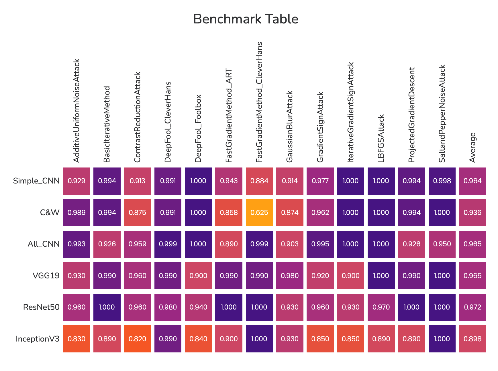

# Robustness Evaluation Benchmark

A Flask-based benchmark platform developed from adversarial-robustness research, visualizing the evaluation results of 6 CNN models against 13 attacks and supporting researcher submissions for further evaluation.

🔗 **Live demo:** https://robustness-evaluation-benchmark.onrender.com



*The `/benchmark` page: robustness of 6 CNN models against 13 adversarial attacks, colour-mapped per cell.*

---

## About

AI image classifiers can be fooled by *adversarial attacks* — tiny, human-imperceptible perturbations to an input that flip the model's prediction. The underlying research from **SY LAB** tackles an upstream question: rather than proposing yet another attack or defence, how do you *measure* how robust a model actually is, in a way that is not biased toward any single attack type?

This site turns those research results into something people can browse and participate in:

- **Benchmark results** — a hand-built heatmap of **6 models × 13 attacks** (MNIST, CIFAR-10, ImageNet), colour-coded by attack success rate so the robustness profile of each model is readable at a glance.
- **Background explainers** — plain-language pages on what adversarial attacks are and how the scoring algorithm approaches robustness.
- **Submission portal** — a validated form where researchers submit a model (`.h5`) or an attack (Python) by URL for the lab to evaluate.

**Models benchmarked:** Simple_CNN · C&W · All_CNN · VGG19 · ResNet50 · InceptionV3
**Attack libraries used in the research:** Foolbox · ART · CleverHans

---

## Features

- Four content routes (`/`, `/about`, `/benchmark`, `/submit`) plus a `POST /sendmail` endpoint
- **Custom data visualisation** — the benchmark heatmap is built directly in HTML/CSS with per-cell colour mapping, no charting library
- **Server-side form validation** — required fields, email format, URL scheme (`http`/`https`), and length limits, with all errors reported at once
- **CSRF protection** on the submission form via Flask-WTF
- **Secrets via environment variables** — no credentials in the codebase; `SECRET_KEY` is generated by the platform
- **Graceful degradation** — if the notification-email API is unavailable the user gets a clear message instead of a silent failure
- Responsive Bootstrap layout with scroll-triggered animations and a lightbox video walkthrough

---

## Tech Stack

| Layer | Tools |
|---|---|
| Backend | Flask 3.1, Jinja2 |
| Forms & security | Flask-WTF (CSRFProtect), WTForms |
| Email delivery | AgentMail HTTP API via `requests` |
| WSGI server | gunicorn |
| Frontend | Bootstrap, jQuery, Owl Carousel, Magnific Popup, Stellar (parallax), animate.css |
| Hosting | Render (native Python runtime) |

---

## Running Locally

```bash
git clone https://github.com/cassielo/robustness-evaluation-benchmark.git
cd robustness-evaluation-benchmark

python3 -m venv venv
source venv/bin/activate          # Windows: venv\Scripts\activate
pip install -r requirements.txt

python app.py
```

Then open http://127.0.0.1:5000.

### Environment variables

All are optional for local browsing — the site renders fine without them. They are only needed for the submission form to actually deliver a notification email.

| Variable | Purpose | Default |
|---|---|---|
| `SECRET_KEY` | Session signing / CSRF tokens | Development-only fallback |
| `AGENTMAIL_API_KEY` | AgentMail API credential | Not set |
| `AGENTMAIL_INBOX_ID` | AgentMail inbox to send from | Not set |
| `MAIL_RECIPIENT` | Where submission notifications go | Not set (configure per deployment) |
| `FLASK_DEBUG` | Set to `1` to enable debug mode | Off |

---

## Project Structure

```
app.py               Flask app: routes, form validation, notification email
requirements.txt     Pinned dependencies
render.yaml          Render deployment config
.python-version      Python version for the host
templates/           index · about · benchmark · submit
static/              css · js · images · fonts · videos
resource/            sample analysis report (for the planned result-delivery feature)
```

---

## Project Status

The site is live and the full submission flow works end to end: a researcher fills in the form, it is validated server-side, and the lab receives a notification email.

**Not yet built:** the automated evaluation pipeline. Submitted models are not currently downloaded, attacked, and scored automatically — evaluation currently requires a separate offline process. Wiring the research team's scoring algorithm into a service that can run against arbitrary user-submitted models is the intended next stage of this project.
